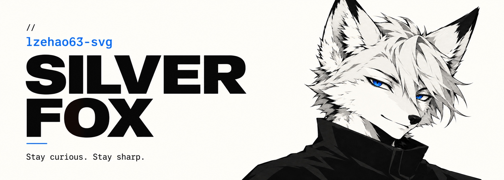

  

  <a href="https://github.com/lzehao63-svg?tab=repositories">代码仓库</a>
  &nbsp;&nbsp; / &nbsp;&nbsp;
  <a href="https://github.com/lzehao63-svg?tab=stars">灵感收藏</a>
  &nbsp;&nbsp; / &nbsp;&nbsp;
  <a href="https://github.com/lzehao63-svg?tab=overview">最近动态</a>

 

> **少一点噪声，多一点作品**
>
> 保持好奇，把想法做出来，把细节磨到顺手

 

---

银狐出没 · Stay curious. Stay sharp.

<!-- Layout adapted from Editorial Card by Awesome GitHub Profile contributors.
     Upstream notice is preserved in THIRD_PARTY_NOTICES.txt. -->

