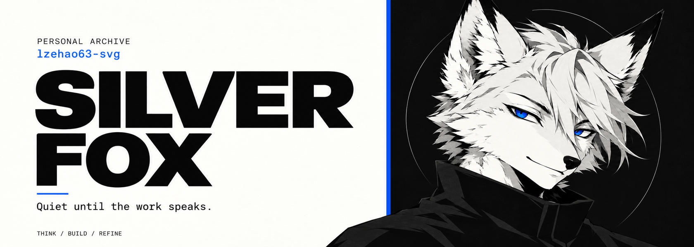

  <picture>
    <source media="(prefers-reduced-motion: reduce)" srcset="./silver-fox-v2.jpg" />
    
  </picture>

  <samp>
    <a href="https://github.com/lzehao63-svg?tab=repositories" title="代码仓库">01 CODE</a>
    &nbsp;&nbsp; / &nbsp;&nbsp;
    <a href="https://github.com/lzehao63-svg?tab=stars" title="灵感收藏">02 FINDS</a>
    &nbsp;&nbsp; / &nbsp;&nbsp;
    <a href="https://github.com/lzehao63-svg?tab=overview" title="最近动态">03 ACTIVITY</a>
  </samp>

 

<strong>保持安静，直到作品开口</strong>

 

---

LESS NOISE &nbsp; / &nbsp; MORE SIGNAL

<!-- Layout adapted from Editorial Card by Awesome GitHub Profile contributors.
     Upstream notice is preserved in THIRD_PARTY_NOTICES.txt. -->

